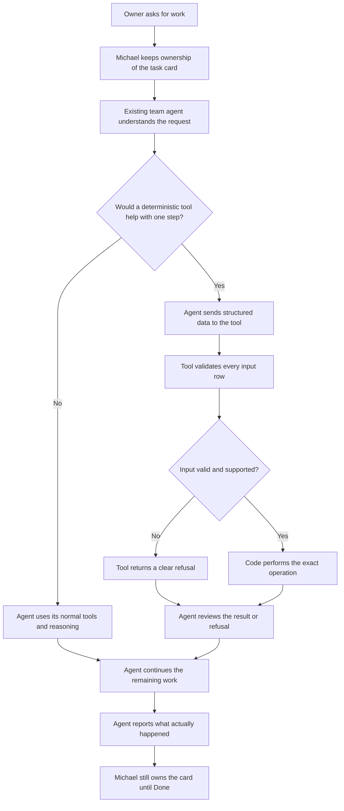
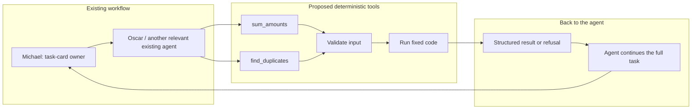

Design Note: Deterministic Tools for Repetitive Office Work
Status: Draft for maintainer review — design only
Related issue: #250
Scope: Two proposed read-only tools. No code changes or savings are claimed.
1. The idea in simple words
Some work needs judgment. The agent should do that work.

Other work follows fixed rules, such as adding amounts or finding rows with the same invoice details. For those small steps, the agent could call a deterministic tool. The tool runs normal code and returns a clear result. The agent then continues the rest of the task.

This is a design proposal, not an implementation.

PR #418 already implemented calculate, find_duplicates, check_data, and task_status, but that PR was closed without being merged. Its basic ideas are not new. The maintainer rejected its approach because message-text matching could give wrong answers and mark cards Done without completing the user's full request. The maintainer asked for tools that an existing agent chooses to call.

The goal here is to define safer tool contracts and a way to test whether they actually help.
2. The first two proposed tools
Tool	What it does	Example
sum_amounts	Adds amounts from rows already selected by the agent.	Add these three invoice amounts.
find_duplicates	Finds rows that match on fields the agent explicitly selects.	Flag invoices with the same supplier and invoice number.

The maintainer may choose to start with just one tool. sum_amounts is the simpler first prototype; find_duplicates should be included only if the agreed test data shows a useful need.

Neither tool chooses the records, converts currencies, edits business data, merges rows, or decides that the whole task is finished.
3. How the agent and tools would work
The existing agent decides whether a tool fits a small step. There is no separate keyword or regex router.

Who would use the tools?
The current SaaS/Consulting pack defines Oscar as the Finance team member. His configured responsibilities include tracking income and expenses, keeping invoices together, flagging overdue invoices, and preparing a weekly money summary. His QuickBooks access is controlled by the existing connector and permissions.

So Oscar is a plausible first user of sum_amounts and find_duplicates for relevant finance tasks. That does not mean the tools are already available to Oscar. The design still needs maintainer approval and implementation through the existing agent-tool mechanism.

Other team members could benefit later if their assigned work involves structured records, but the first version should not create new agents or reassign tasks.
Responsibilities

The diagrams show the proposed design only. They do not claim that the tools or this exact connection exist today.
4. Tool 1 — sum_amounts
Input example
{
  "version": 1,
  "currency": "USD",
  "decimal_places": 2,
  "amount_field": "amount",
  "group_by": "client",
  "rows": [
    {"client": "Northwind Cafe", "amount": "1250.10"},
    {"client": "Northwind Cafe", "amount": "249.90"},
    {"client": "Harbor Dental", "amount": "975.50"}
  ]
}
Expected result
- Overall total: 2475.50
- Northwind Cafe: 1500.00
- Harbor Dental: 975.50
Proposed success response
{
  "ok": true,
  "tool": "sum_amounts",
  "version": 1,
  "currency": "USD",
  "row_count": 3,
  "total": "2475.50",
  "groups": [
    {"key": "Northwind Cafe", "total": "1500.00"},
    {"key": "Harbor Dental", "total": "975.50"}
  ]
}
When it must refuse
The tool returns a structured error instead of a total when:
- A required field is missing or has the wrong type.
- Any amount is invalid, ambiguous, or has unsupported decimal precision.
- The currency or precision is unsupported.
- The requested grouping field does not exist.
- The input is too large or exceeds the agreed row limit.
The implementation should use one documented refusal shape, for example {"ok": false, "tool": "sum_amounts", "version": 1, "error_code": "INVALID_AMOUNT", "message": "Amount must be a valid decimal string.", "affected_rows": [1], "affected_fields": ["amount"]}. Exact maximum row count, payload size, supported currency codes, and decimal-precision limits are explicit review decisions and must be fixed before implementation.

It must validate all rows before calculating. It must not silently skip bad rows, guess an amount, convert currencies, or edit source data. Exact decimal arithmetic or integer minor units should be used, not ordinary binary floating-point addition.

The agent remains responsible for selecting the correct rows and explaining what the total means.
5. Tool 2 — find_duplicates
Input example
{
  "version": 1,
  "key_fields": ["supplier", "invoice_no"],
  "match": "normalized",
  "missing_key": "refuse",
  "label_field": "invoice_no",
  "rows": [
    {"supplier": "Acme Paper", "invoice_no": "A-77", "amount": "410.00"},
    {"supplier": "ACME  paper", "invoice_no": "a-77 ", "amount": "410.00"},
    {"supplier": "Acme Paper", "invoice_no": "A-78", "amount": "95.25"}
  ]
}
Matching rules
Version 1 should support two modes:
- exact: selected key values must match exactly.
- normalized: trim leading/trailing spaces, collapse repeated spaces inside text, and compare text without case differences.
In this example, the first two rows should be flagged together in normalized mode. The third row should not match.

Every selected key field must match. This is not fuzzy matching: the tool must not guess that misspelled or similar names belong to the same business.
Proposed success response
{
  "ok": true,
  "tool": "find_duplicates",
  "version": 1,
  "match": "normalized",
  "row_count": 3,
  "duplicate_groups": [
    {
      "group_id": 1,
      "key": {"supplier": "acme paper", "invoice_no": "a-77"},
      "rows": [
        {"row_index": 0, "label": "A-77"},
        {"row_index": 1, "label": "a-77 "}
      ]
    }
  ]
}
When it must refuse
The tool returns a structured error when:
- Required fields are missing or have the wrong type.
- key_fields is empty or refers to a field that is not present.
- The matching mode is unsupported.
- A selected key is missing while missing_key is refuse.
- The data is malformed or exceeds the agreed size limit.
The refusal response should use the same stable error envelope as sum_amounts, with a tool-specific error_code and affected row/field details where available. Exact maximum row count and payload size must be agreed before implementation.

If any selected key is missing under the refuse policy, the tool must refuse the whole call instead of returning a partial result that looks complete. It must never merge or delete records. A duplicate group means “these rows match the stated rules,” not “these are definitely the same real-world transaction.”
6. Shared rules for both tools
1. Requests and responses include a contract version.
2. Validate the complete input before returning a result.
3. Errors have a stable code, a plain-language explanation, and affected rows or fields where useful.
4. No partial result may be presented as complete success.
5. Both tools are read-only and do not change invoices, records, or task cards.
6. Neither tool calls an LLM or chooses another tool.
7. The calling agent remains responsible for the overall task.
8. A tool result does not mean the user's whole request is complete.
7. How to connect the tools to agents
The maintainer asked us to build on existing agent-tool patterns, not add a separate routing system.

The implementation should first confirm the exact current mechanism that provides tools to an agent, then expose the approved tool through that same mechanism. A script or CLI is only one possible implementation; this document does not assume it is the correct path.

The design must not add:
- Keyword or regex matching before an agent receives a task.
- Automatic model/provider switching. The owner chooses the model/provider; the app may suggest a change only when it is backed by measurements, consistent with the separate model-choice work in issue #64.
- Code that creates, moves, or finishes task cards.
- A second system that competes with Michael for ownership.
The agent should receive the tool's structured result, inspect it, and continue the work. Michael remains responsible for the card and its completion.
8. Benchmark: does this actually help?
Use the same task wording and structured data in comparable sessions:
1. Baseline: the agent does the task without the proposed tool.
2. Tool-assisted: the same agent can call the approved deterministic tool.
Measure each run:
- Correctness against a known expected answer.
- Whether the entire user request was completed.
- Input/output/cached tokens where available.
- Total time, including preparing arguments and tool overhead.
- Tool calls, refusals, retries, failures, and incomplete runs.
- Cost, only if reliable measurements are available.
Use repeated runs and report failures separately. Count tool descriptions, arguments, results, extra agent turns, and retries. A small task might cost more with a tool. A fast but wrong or incomplete task is not a success. No token savings or performance improvement is claimed before testing.
9. Agent-to-agent handoff is not part of this first step
This proposal returns a tool result to the same agent that called it. It does not assume that the app already supports a structured tool → Agent B handoff.

Sending a message to another agent may avoid some manual copying, but the receiving agent may still need its own model turn. Direct handoff should be a separate architecture question, not a hidden dependency for these tools.
10. Questions for maintainer review
1. Should the first prototype include only sum_amounts, or both tools?
2. Is Oscar the right first configured agent for the approved finance subtask?
3. Which existing agent-tool delivery mechanism should be reused? The implementation must follow the app's existing way of handing tools to agents, not introduce a parallel invocation path.
4. Which safe, representative data and expected answers should be used in tests?
5. Which token, completion, correctness, timing, and cost metrics are available?
6. Should agent-to-agent handoff remain out of scope for this prototype?
7. What exact input-size and row-count limits should the first tool contracts enforce?
11. Proposed phases
Phase	Work	Decision
1. Design review	Agree on tools, contracts, Oscar/agent mapping, delivery mechanism, and benchmark.	Maintainer approves or requests changes.
2. Prototype	Implement only the approved scope and test valid/invalid inputs.	Tests show predictable, safe behavior.
3. Measure	Compare baseline and tool-assisted runs.	Evidence shows whether correctness, time, and token usage improve.
4. Expand if justified	Consider the second tool or more repetitive tasks.	Measured results support expansion.

Closing
Let agents handle understanding, unclear requests, and decisions. Let deterministic code handle small repetitive operations when the rules and input are clear.

Start small, keep Michael in control of the task card, and use measurements—not assumptions—to decide whether this approach is worth expanding.
