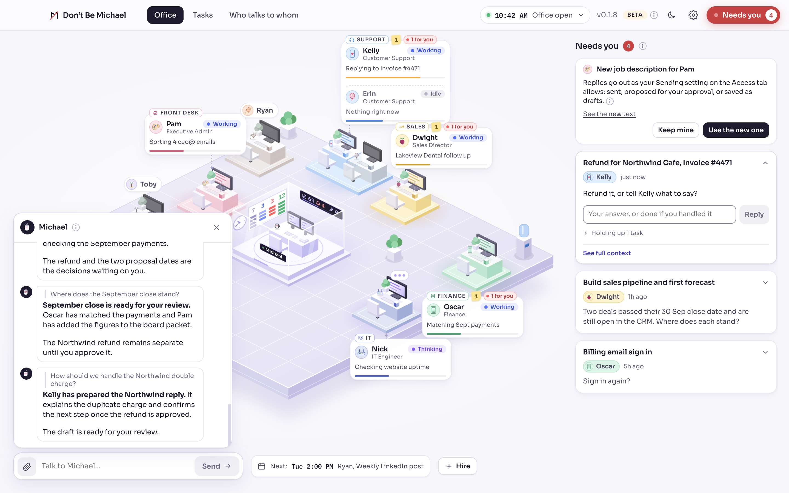
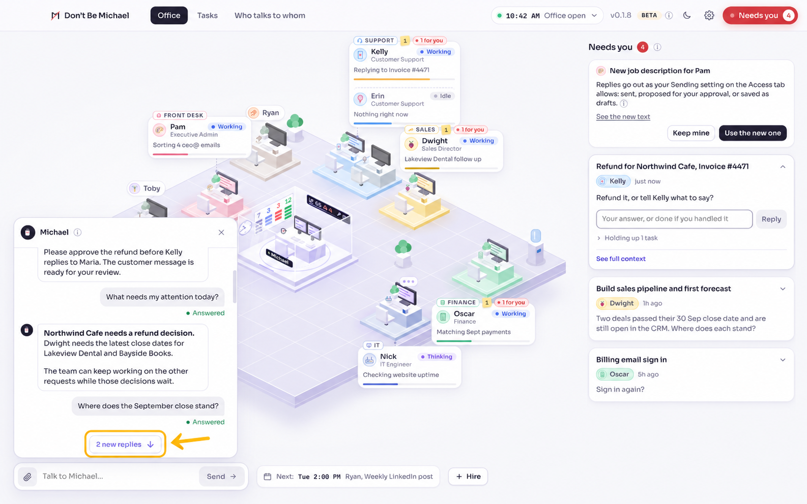
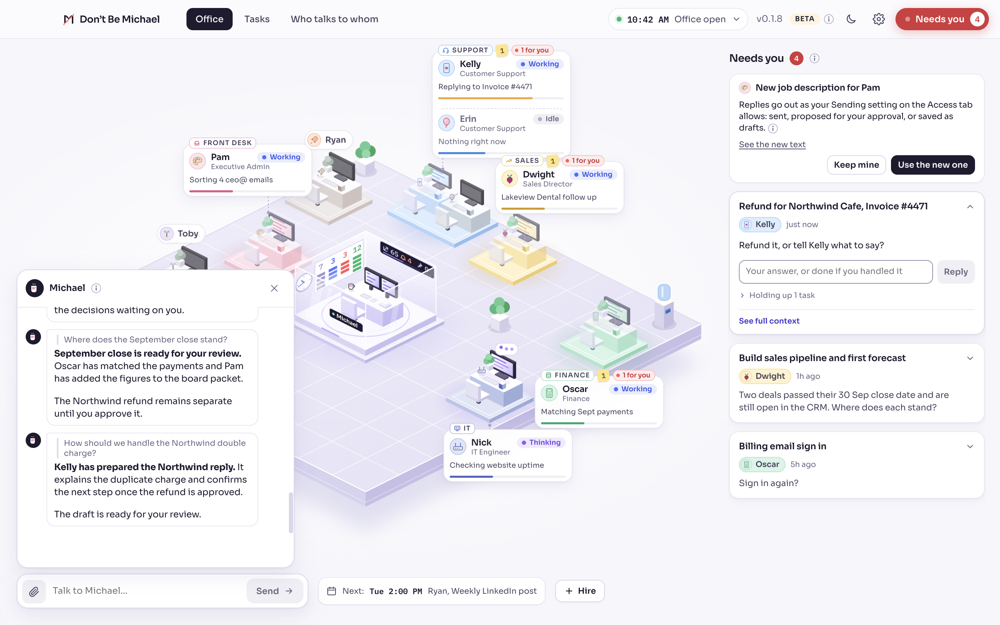

# Keep your place in the conversation

New replies follow the reader only while they are at the bottom of the dock.
When they scroll back, the dock keeps the visible message at its previous
offset and offers a quiet button to catch up. Opening, sending and question
links remain explicit navigation actions, including repeated navigation to
the same question.

The footer is reserved so the button does not resize the reading viewport.
Its count is local to this open dock: distinct arriving replies, with notes
shown as Jump to latest. It does not change the persisted unread count or
the existing read and notification policy. Earlier history, repeated polls
and status edits do not add to the arrival count. Expanding More preserves
the text being read, including at the bottom. The baseline includes folded
exchanges, so revealing Earlier never counts an existing reply. New reply
IDs below the reader count even if their timestamps precede the latest
known reply. Both the button and manual catch-up cancel any unresolved
question target. A scroll that precedes its browser event is reconciled from
the previous layout, so arrivals in the same frame preserve the new passage.
The button disappears once used, so activating it returns focus to the
composer, as closing the dock does.

## Implementation guide

| Area | Responsibility |
| --- | --- |
| `src/renderer/src/shell/useDockScroll.ts` | Keeps transient follow intent, row geometry, seen reply keys, pending navigation and arrival counts for the open dock, and the place a move between the bar and the center reopens on. |
| `src/renderer/src/shell/MichaelDock.tsx` | Passes each row's dock key (`dockKeys.ts`, since message ids can repeat), connects scroll events and the container observer, reserves the catch-up footer, reveals hidden targets and returns button focus to the composer. |
| `src/renderer/src/store/store.ts` | Increments `dockNavigation` on explicit `setDock` calls, including repeated navigation to the same question. This state is not persisted. |
| `src/renderer/src/i18n/locales/` | Supplies catch-up text and plural categories for English, Chinese and Arabic. |
| `test/dock-scroll.electron.test.cjs` and `test/fixtures/dock-scroll*` | Mount the production renderer and store with fictional history and mocked main-process APIs; assert actual Chromium geometry and keyboard input. |

The hook captures each row's dock key (`data-k`) and offset before layout changes.
A passive commit restores the first surviving row overlapping the viewport,
unless the reader is following within 32 px of the bottom. Explicit navigation
is consumed once, clears arrivals and takes precedence over passive restoration.
A missing target remains pending until it appears or catch-up supersedes it.

A scroll event counts as the reader's only when `scrollTop` moved. Content that
grew since the last measure (late fonts, a reply's fold measured, a file chip)
moves the bottom, not the reader, and the container observer follows it.

The dock is mounted again when it moves between the bar and the center (the
wide 1:1). The hook records the first row in view and its offset in the
composer's `DockView.anchor` while the owner reads, and nothing while following
the latest. A fresh mount opens on that row at the same offset, ahead of the
question the dock was first opened for. Closing the dock clears it.

Chromium may change `scrollTop` before dispatching a scroll event. Before a
passive commit or resize, the hook reconciles that movement against the previous
scroll height and row geometry. This prevents an arrival in the same frame from
mistaking a newly scrolled reader for someone still following the bottom.

The full history is the seen-ID baseline, including folded exchanges. Newly
rendered replies below the viewport can count regardless of timestamp; revealing
old history and repeated snapshots do not. Notes enable catch-up without adding
to the reply number. Catch-up clears the local arrival set and resumes following.

One `ResizeObserver` watches the list and content container, then disconnects
when the dock closes. Each folded reply already measures its own fold with an
observer; the hook adds no per-row observers, background timers or new
dependencies. Capturing row rectangles is linear in rendered history; this
change does not add virtualization. Delivery, file handling, notification APIs
and persisted unread state keep their existing paths.

## Before and after

The original images are unedited Electron captures of the full production `App` renderer,
including the office floor, composer and Needs you panel. They use the same
fictional Harbor & Pine office, light theme and 1440 by 900 window. The office
data and preload boundary are simulated; these captures demonstrate UI behavior,
not live provider delivery. The baseline dock is `main` at `b33bbde2`; the
changed renderer is `6e018157`. Both start at `scrollTop = 200` before two
replies arrive through the production conversation subscription.

### Before: arrivals interrupt reading

The baseline moves to `scrollTop = 1327`, showing the new replies instead of the
earlier passage.



### After: the reader chooses when to catch up

The branch stays at `scrollTop = 200`, preserving the passage and showing
"2 new replies" in the reserved footer.



The amber outline and arrow highlight **2 new replies** for review. This annotated
copy was made with the built-in image editor; the [original capture](keep-conversation-position/after-arrivals.png)
is available for comparison.

Activating the button reaches the latest replies, clears the count and resumes
following. When the button held focus, focus returns to the composer.



## In-app behavior

Open a conversation and scroll back to an earlier answer. When replies arrive,
the passage stays in place and the catch-up control shows the number of new
replies. Activate it to reach the latest replies and resume following, or
scroll to the bottom yourself. Notes use Jump to latest. Following a
notification or sending a message remains explicit navigation. A quoted
question scrolls the list to it without claiming the center, as reading does. The screenshots above show the reading and catch-up states in
the complete office interface.

## Automated verification

```sh
node --test test/dock-scroll.electron.test.cjs
npm run typecheck
npm run test:focused
npm run build
```

The Electron test mounts the production component with actual Chromium
geometry, using a temporary path containing spaces. It checks normal and
reduced motion, following, visible anchors, arrivals, duplicate polls, notes,
status reflow, Earlier, hidden and missing targets, repeated navigation,
quotes, expansion, resize, asynchronous child layout, item removal, send
success and failure, delayed targets, initial history, reopening, Escape,
file chips, folded exchanges, delayed arrivals below the reader, catch-up
superseding pending navigation, all locales, both themes and a short window.
Real key presses reach the button from the composer with Shift+Tab, activate
it with Space and check that focus returns to the composer.
Geometry comparisons allow one CSS pixel for fractional layout rounding.

The test also runs three fixed seeds of 50 mixed actions in each motion mode,
30 reply bursts without waiting between commits, a 200-exchange history,
the follow threshold, same-frame scroll/arrival/history races, selector-safe
targets and 20 open/close cycles with native observer cleanup checks. It fails
on uncaught renderer errors and unhandled promise rejections. Seeded actions
check a separate expected arrival set and measured reading anchors after
each step; failed seeds are reproducible.

For an installed-office smoke test, use `npm run dev` and repeat the reading
and catch-up sequence with existing conversations. Verify notification
navigation and normal composer sending in that environment. Fixture results
do not establish provider delivery, OS notifications or screen-reader speech.
Windows and Linux need their own run; Linux needs a graphical session or Xvfb.

## Review notes and limits

Independent Claude Code review caught focus loss when the catch-up button
unmounted. Returning focus to the composer keeps Escape usable. The regression
uses real Shift+Tab and Space input, with assertions after each input event.

Anchoring is at row granularity. If the partially visible top row changes height
at its bottom, the passage below it can shift by that amount. Keeping that row
anchored protects More expansion; preserving a character inside an edited row
would require a separate sub-row anchoring design. This limitation remains.

The renderer is provider neutral and tests use subprocess argument arrays and
Node path helpers, including temporary paths with spaces. This does not replace
Windows or Linux execution, live-provider delivery, OS notification clicking,
or screen-reader speech testing.
