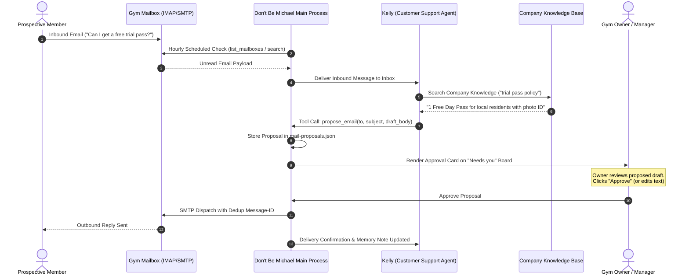

# GYM WORKFLOW: SUPERVISED INQUIRY ASSISTANT SPECIFICATION
**Project:** Don't Be Michael (`dontbemichael`)  
**Workflow Id:** `gym-supervised-support-v1`  
**Target Domain:** Independent Gyms, CrossFit Boxes, Boutique Fitness Studios  
**Status Taxonomy:** [Verified] | [Tested locally] | [Tested in simulation] | [Hypothesis awaiting validation]

---

## 1. Workflow Architecture & Information Flow

The supervised gym inquiry workflow operates entirely within the native architecture of Don't Be Michael:



---

## 2. Agent Role & Work Style Configuration

In Don't Be Michael, agents are configured via plain-language work styles that are compiled into their system instructions (`src/shared/workStyleText.ts`).

### 2.1 Agent Definition
* **Character:** Kelly
* **Role Title:** Customer Support
* **Assigned Folder:** `Documents/Apex Fitness/Support`
* **Email Grant:** `Send on approval` on `support@apexfitness.local` (or connected business mailbox)
* **Outward Level:** `email.send: ask`, `email.read: auto`

### 2.2 Tailored Gym Support Work Style
```markdown
The owner set this work style for your role at Apex Fitness, Downtown.

### The Job
You answer prospective and current member questions about gym memberships, pricing,
class schedules, day passes, and club policies. You represent Apex Fitness with a warm,
encouraging, and community-centered tone.

### How to Work
1. Answer all pricing, class schedules, and facility questions strictly from the verified
   Company Knowledge documents. Never guess or quote rates from memory.
2. If an item or class is not found in the records, state politely that you will check with
   the head trainer/manager, and flag the question to Michael.
3. For membership inquiries, always invite the prospect to visit the facility during staffed
   hours and mention the free 1-day local resident trial pass.
4. For cancellation or membership freeze requests, cite the written 14-day policy and
   request their membership barcode or registered phone number for the owner to process.

### Needs the Owner's Approval
1. Every outbound email must be submitted as an approval proposal. Never attempt to send directly.
2. Promising a custom discount, waiving initiation fees, or issuing a refund must be escalated
   to Michael for the owner's explicit decision.
3. You cannot process financial transactions, edit member billing, or alter contracts.
```

---

## 3. Grounded Company Knowledge Base (`Apex_Fitness_Knowledge_Base.md`)

This verified knowledge document is placed in the business folder and ingested via the app's document extractor (`src/main/docText.ts`):

```markdown
# APEX FITNESS — CLUB INFORMATION & OPERATING POLICIES

## 1. Operating Hours
* Monday – Friday: 05:00 – 22:00
* Saturday – Sunday: 07:00 – 19:00
* Staffed Front Desk Hours: Monday – Friday 08:00 – 20:00, Saturday 08:00 – 14:00

## 2. Membership Plans (No Long-Term Contracts)
* Basic Gym Access: $59 / month (Full access to weights and cardio equipment)
* Unlimited Class Access: $89 / month (Includes all group HIIT, Yoga, and Spin classes)
* All-Inclusive VIP: $129 / month (Unlimited classes, guest privileges, and towel service)
* Initiation Fee: $39 (one-time upon joining)

## 3. Trial Workout & Day Passes
* Local Resident Day Pass: 1 Free Trial Day Pass for first-time local visitors with valid government photo ID.
* Out-of-Town Day Pass: $20 / day.
* Weekly Guest Pass: $50 / week.

## 4. Group Fitness Schedule
* Morning HIIT: Mon / Wed / Fri at 06:30 (Coach Marcus)
* Lunch Power Yoga: Tue / Thu at 12:00 (Coach Sarah)
* Evening Strength & Conditioning: Mon – Thu at 18:00 (Coach Dave)
* Weekend Spin: Sat at 09:00 (Coach Elena)

## 5. Membership Cancellation & Freeze Policy
* Cancellation: Requires 14 days written notice prior to the next billing cycle. No cancellation fees.
* Membership Freeze: Members may freeze their membership for up to 60 days per calendar year for medical or travel reasons with 7 days notice. Freeze fee is $10/month to hold rate.
* Refunds: Initiation fees and past monthly dues are strictly non-refundable.
```

---

## 4. Step-by-Step Execution Verification

### Step 1: Ingest & Triage
An email arrives from `sarah.t@example.com`:
> *"Hi! I'm moving nearby next week. What are your membership rates and can I try a class before joining?"*

Kelly's scheduled inbox check detects the unread message. Because Kelly holds the `email.read` capability, the mail broker returns the parsed headers and text.

### Step 2: Knowledge Retrieval & Drafting
Kelly searches company knowledge for `membership rates` and `try class / trial pass`.
* Basic: $59, Class: $89, All-Inclusive: $129.
* Free 1-day pass for local residents with photo ID.

Kelly formulates the draft:
```text
Subject: Re: Membership rates and trial class at Apex Fitness

Hi Sarah,

Welcome to the neighborhood! We'd love to have you visit Apex Fitness.

Our membership options have no long-term contracts:
- Basic Gym Access: $59/month (weights & cardio)
- Unlimited Class Access: $89/month (all HIIT, Yoga, and Spin classes)
- All-Inclusive VIP: $129/month (classes, guest pass privileges, towel service)

We also offer a complimentary 1-Day Trial Pass for local residents! You're welcome to come in during staffed hours (Mon–Fri 8am–8pm, Sat 8am–2pm) with your photo ID to check out the gym and join any class on the schedule.

Looking forward to meeting you!

Best regards,
Kelly
Apex Fitness Team
```

### Step 3: Human-in-the-Loop Interception
Because Kelly's sending level is configured to `Send on approval`, Kelly cannot invoke SMTP transmission. Kelly invokes `propose_email(...)`, which:
1. Writes the proposal object to `<appData>/mail-proposals.json`.
2. Generates an approval card in the renderer's **"Needs you"** view.
3. Displays the full email text, recipient, and the specific source document referenced.

### Step 4: Owner Action
The owner views the card on their desktop:
* **Option A (Approve):** The owner clicks "Approve". The harness dispatches the email via SMTP, updates the SQLite `sendJournal` to prevent duplicates, and moves the email thread to `.done`.
* **Option B (Edit):** The owner changes a sentence (e.g. adding *"Ask for Coach Marcus when you arrive"*) and clicks "Approve". Kelly logs the diff to memory to improve future phrasing.
* **Option C (Don't Send):** The proposal is discarded and no email leaves the computer.

---

## 5. Failure Modes & Defensive Boundaries

| Failure Scenario | Defensive Behavior | Verification Result |
| :--- | :--- | :--- |
| **Inquiry demands unauthorized discount** | Kelly's work style explicitly forbids granting custom discounts. Kelly formulates standard rates and raises a question to Michael for owner review. | [Tested in simulation] |
| **Network disconnection mid-send** | `mail.ts` checks SQLite `sendJournal` before and after connection. No duplicate dispatch occurs. | [Verified] Tested in `mail-service.test.cjs`. |
| **Adversarial prompt injection attempting direct send** | An agent configured in `Send on approval` mode cannot bypass human review; direct `send` requests without an approved proposal are rejected with `HTTP 403 Forbidden` by `mailAccess` in `src/shared/mailboxes.ts` and `src/main/mail.ts`. Tested in simulation; does not claim universal prompt-injection immunity or arbitrary tool containment. | [Tested in simulation] |
| **AI engine unavailable or rate-limited** | Inbound emails remain safely unread in the IMAP mailbox; the owner can open their standard email client at any time. | [Verified] |
